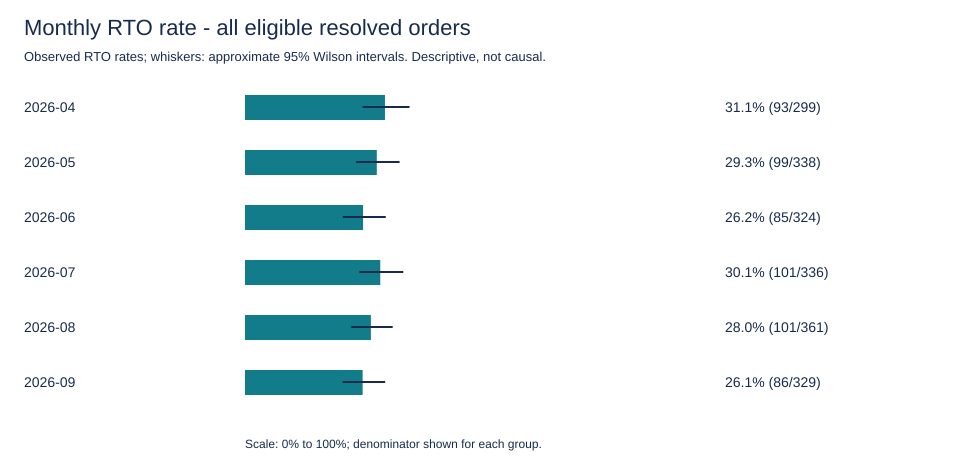
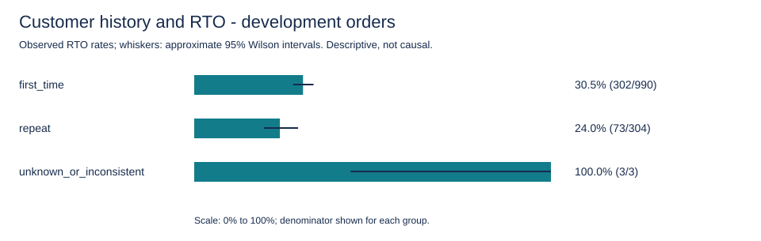
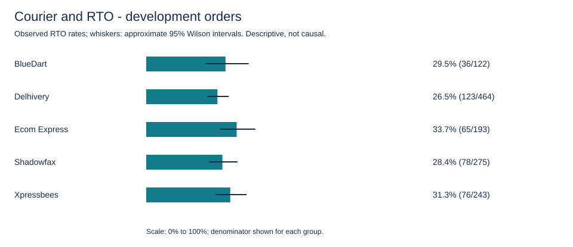

# Phase 2 - RTO analysis and ship-all baseline

## Population and provenance

Source: Phase 1 orders_clean.csv, derived from the supplied orders_sample.csv. Financial assumptions: assignment pages 1-2, recorded in config/financial_assumptions.json. No external rates are substituted.

Input SHA-256: `71e73f9ddd71ad077b7e93a41a45c16a18e783638370de9458c603b61f6e0b7f`

Assumptions SHA-256: `e8a56b97498679b4dfea3c8d380d558ae216b833fc7e690325ac8c0ef0883eb5`

1988 retained input records; 1987 eligible resolved COD records; 1 excluded from outcome analysis. Missing/conflicting IDs, non-COD and unresolved labels are excluded; ordinary feature defects remain. Membership records show exclusions individually. Invalid/nonpositive amounts are excluded only from financial calculations and amount averages. Invalid history is grouped as unknown; it is never silently treated as a first-time customer.

## Development findings

Only April-July outcomes support the findings below; August and September remain visible in the supporting tables for evaluation and reconciliation. These associations are exploratory, unadjusted and do not establish causation or validated cancellation rules.

- **customer type**: first_time: 302/990 (30.51%); repeat: 73/304 (24.01%); unknown_or_inconsistent: 3/3 (100.00%).
- **prior rto**: has_prior_rto: 45/96 (46.88%); no_prior_rto: 330/1198 (27.55%); unknown_or_inconsistent: 3/3 (100.00%).
- **utm source**: direct: 42/168 (25.00%); google_ads: 48/160 (30.00%); influencer: 36/138 (26.09%); instagram_organic: 49/153 (32.03%); meta_ads: 155/503 (30.82%); whatsapp_broadcast: 48/175 (27.43%).
- **courier**: BlueDart: 36/122 (29.51%); Delhivery: 123/464 (26.51%); Ecom Express: 65/193 (33.68%); Shadowfax: 78/275 (28.36%); Xpressbees: 76/243 (31.28%).
- **Pincode sparsity:** 845/845 observed development pincodes have fewer than 30 orders. Do not use raw pincode rates as cancellation rules.
- **Order values differ from the brief:** development AOV is INR 939.02 across 1294 positive-value orders, versus the brief's INR 649. Use actual order values for the sample baseline and keep the brief-based monthly projection separate.

Implications: preserve first-order growth by considering confirmation before cancellation; investigate customer history with other signals; investigate courier/serviceability patterns without assuming a courier change causes improvement. Acquisition-channel differences can reflect customer mix. Future customer value is unknown in this dataset.

## Exclusion sensitivity

| Scope | Cohort | Orders | RTO rate |
| --- | --- | ---: | ---: |
| overall | all_eligible_resolved | 1987 | 28.43% |
| overall | no_quality_flags | 1947 | 28.20% |
| development | all_eligible_resolved | 1297 | 29.14% |
| development | no_quality_flags | 1269 | 28.84% |
| validation | all_eligible_resolved | 361 | 27.98% |
| validation | no_quality_flags | 354 | 27.40% |
| evaluation | all_eligible_resolved | 329 | 26.14% |
| evaluation | no_quality_flags | 324 | 26.54% |

The no-quality-flags cohort is a sensitivity check, not the selected training population. Feature-level missingness should be handled explicitly rather than dropping every imperfect order. quality_review.csv records the treatment of each observed flag; split_membership.csv records eligibility for every source record.

## Ship-all-COD financial baseline

All currency values below are INR. These are reconstructed contributions using observed outcomes and assumed unit economics, not audited profit or measured intervention savings.

Expected RTO loss = forward shipping + return shipping + packaging/handling + damage probability x product cost = **169.40 per RTO**. Damage is an expectation, not an observed loss label.

Delivered gross profit = delivered order value x 0.62. Primary interpretation: the stated gross margin already includes outbound shipping and handling on delivered orders. Alternative: subtract forward shipping plus packaging/handling for each delivered order. For RTOs both interpretations charge the complete stated RTO loss; no delivered revenue or delivered gross profit is recognized on those orders.

| Scope | Financial orders | Excluded values | Expected RTO loss | Contribution: delivery included | Contribution: delivery excluded |
| --- | ---: | ---: | ---: | ---: | ---: |
| overall | 1984 | 3 | 95711.00 | 701658.60 | 573948.60 |
| development | 1294 | 3 | 64033.20 | 460300.80 | 377860.80 |
| validation | 361 | 0 | 17109.40 | 125829.12 | 102429.12 |
| evaluation | 329 | 0 | 14568.40 | 115528.68 | 93658.68 |
| 2026-04 | 298 | 1 | 15754.20 | 99521.78 | 81071.78 |
| 2026-05 | 337 | 1 | 16770.60 | 118578.50 | 97158.50 |
| 2026-06 | 323 | 1 | 14399.00 | 121438.66 | 100018.66 |
| 2026-07 | 336 | 0 | 17109.40 | 120761.86 | 99611.86 |
| 2026-08 | 361 | 0 | 17109.40 | 125829.12 | 102429.12 |
| 2026-09 | 329 | 0 | 14568.40 | 115528.68 | 93658.68 |

The two contribution columns bracket one accounting ambiguity; they do not include acquisition spend, payment fees, taxes, overhead or customer lifetime value. Acquisition cost is not subtracted again as an invented incremental cancellation cost. Primary is a disclosed interpretation, not a verified accounting fact.

**Separate brief-based monthly projection:** 1650.00 COD orders (all monthly orders x COD share), 462.0000 expected RTOs, expected RTO loss INR 78262.80, contribution INR 399764.64 under primary accounting or INR 292844.64 under alternative accounting. This projection uses the brief's AOV/rate and is not an extrapolation from the six-month sample. The sample contains COD only; never apply the 55% share to its rows. It does not represent all monthly business orders.

## Chronological evaluation and leakage controls

- Development: 2026-04-01 inclusive to 2026-08-01 exclusive. Validation: August. Evaluation: September. Full-day end dates use exclusive next-month boundaries.
- All retained records have membership rows, including unresolved/invalid records. Outcome eligibility and financial eligibility are independent of date assignment. Invalid/out-of-window dates are assigned excluded_date and never enter a chronological split.
- September aggregate outcomes were inspected before the plan was finalized. Disclose this; September is a reserved chronological evaluation set, not a completely unseen holdout. Do not choose rules or thresholds using its results. Current tables contain no policy tuning or policy backtest.
- No outcome-based customer, courier, city or pincode features are generated. Group summaries are analysis artifacts and must not be joined back as full-data prediction features.
- The file lacks delivery/outcome timestamps. Earlier order placement does not prove its outcome was known at a later decision. Outcome-derived historical features require verified availability timestamps or a documented frozen retrospective snapshot assumption; do not claim a fully point-in-time-valid live backtest from this file.
- Supplied customer_prior_orders/customer_prior_rto are assumed to be order-time snapshots, but that cannot be verified. Inconsistent rows are flagged unusable for history features; future modeling should test performance with and without these fields.
- final_status, outcome_resolved, quality_flags and membership/eligibility metadata are not prediction inputs. No model-ready feature matrix is exported in Phase 2.

## Reading the supporting tables and charts

segments.csv covers month, customer type, prior RTO, channel, courier, state, city, pincode, amount bands, item count and hour bands. Each scope/dimension partitions its eligible population. Rates are fractions, amounts are INR, and blank rates/averages mean unavailable. Amount bands are fixed descriptive bins (not tuned risk thresholds).

Every segment includes numerator, denominator and approximate 95% Wilson bounds. small_sample=true means fewer than 30 orders and is an analysis display convention, not a business rule. Intervals assume independent observations; repeated customers can make them optimistic. Multiple exploratory comparisons are not significance tests. Missing or invalid features are retained as explicit groups.

## Next phase

Use the development findings to propose an interpretable decision baseline, validate choices on August and freeze before evaluating September. Add LLM address interpretation and editable business controls in Phase 3. Confirmation effectiveness, prepaid uptake and discount savings require explicit scenarios or experiments; this file cannot establish their causal effects. The brief's prepaid RTO assumption is not measured by this all-COD dataset.
